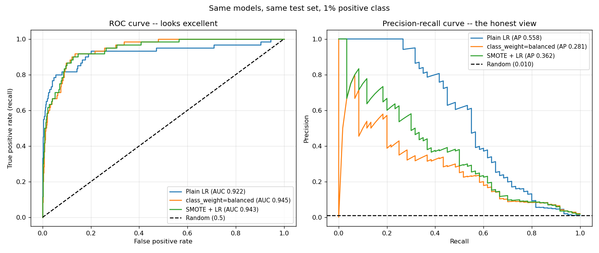

# ML Fundamentals – Imbalanced Data: class_weight, SMOTE & PR Curves

One script, one figure. Synthetic data with a **1% positive class** (20,000 rows,
stratified 70/30 split → 60 positives in the test set). It teaches the
"99% accuracy on a 1% positive class" lesson, then compares the two standard
fixes.

## Run

```bash
cd imbalanced_data
python ImbalancedClassification.py
```

Needs only `numpy`, `scikit-learn`, `matplotlib`. SMOTE is implemented by hand
(~10 lines) so `imbalanced-learn` is not required. Writes `plots/roc_vs_pr.png`.

## Results (as measured)

| Model | Accuracy | Precision | Recall | F1 | ROC-AUC | PR-AUC |
|---|---|---|---|---|---|---|
| Always negative | **0.9900** | 0.0000 | 0.0000 | 0.0000 | 0.5000 | 0.0100 |
| Plain LR | 0.9927 | 0.8077 | 0.3500 | 0.4884 | 0.9220 | **0.5584** |
| `class_weight="balanced"` | 0.8963 | 0.0781 | **0.8667** | 0.1433 | **0.9446** | 0.2813 |
| SMOTE + LR | 0.9105 | 0.0852 | 0.8167 | 0.1543 | 0.9432 | 0.3619 |

Accuracy, precision, recall and F1 use the default 0.5 threshold. ROC-AUC and
PR-AUC (average precision) don't use a threshold.



## What was learned

- **Accuracy is useless here.** A model that never predicts the positive class
  scores 0.9900. Plain LR "improves" this to 0.9927 while missing 65% of the
  positives.
- **ROC-AUC flatters too.** All three real models look excellent on ROC
  (0.92–0.94), because the false positive rate is divided by ~5,940 negatives,
  so hundreds of false alarms barely move it. Precision has no such cushion.
  The random baseline makes the difference obvious: ROC-AUC 0.5 vs PR-AUC
  0.01 (the prevalence).
- **`class_weight` and SMOTE mainly move the threshold.** Both push recall from
  0.35 to ~0.85 and drop precision from 0.81 to ~0.08. That's a different point
  on the same trade-off, not a better model. You could get a similar effect by
  lowering plain LR's threshold.
- **A surprise I didn't expect: the rebalanced models rank *better* by ROC-AUC
  but *worse* by PR-AUC** (0.56 → 0.28 / 0.36). Reweighting changes the fitted
  boundary to get the bulk of positives right, which costs precision at the
  top of the ranking, where PR-AUC puts its weight. The two "threshold-free"
  metrics pick different winners, so you have to decide which one fits the
  problem.
- **Resample the training set only.** SMOTE runs after the split, so the test
  set keeps its real 1% prevalence. Oversampling before the split would leak
  synthetic copies of test rows into training.
- **Caveat:** 60 test positives is few, so PR-AUC differences of a few points
  are noise. The direction of the results is the lesson; the exact numbers
  are not.
