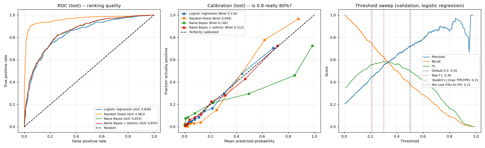

# ML Fundamentals – Model Evaluation: ROC/AUC, Calibration & Threshold Selection

One script, one figure. A classifier gets judged on three separate questions,
and a model can pass one and fail another:

1. **Ranking:** does it score positives above negatives? → ROC-AUC
2. **Calibration:** when it says 0.8, is it right 80% of the time? → calibration curve, Brier score, log loss
3. **Decision:** which threshold turns probabilities into actions? → picked on a validation set, scored on test

Synthetic data: 10,000 rows, 20% positive, split 60/20/20 into train / validation / test.

## Run

```bash
cd model_evaluation
python ModelEvaluation.py
```

Needs only `numpy`, `scikit-learn`, `matplotlib`. Writes `plots/evaluation.png`.

## Results (as measured)

**Ranking and calibration (test set):**

| Model | ROC-AUC ↑ | Brier ↓ | Log loss ↓ |
|---|---|---|---|
| Logistic regression | 0.8379 | 0.1161 | 0.3733 |
| Random forest | **0.9633** | **0.0486** | **0.2007** |
| Naive Bayes | 0.8528 | 0.1400 | 0.5169 |
| Naive Bayes + isotonic | 0.8528 | 0.1123 | 0.3618 |

**Threshold selection (logistic regression, threshold picked on validation, scored on test).**
Cost assumes a missed positive costs 5× a false alarm:

| Rule | Threshold | Precision | Recall | F1 | Cost |
|---|---|---|---|---|---|
| Default 0.5 | 0.500 | 0.6793 | 0.3956 | 0.5000 | 1306 |
| Max F1 | 0.300 | 0.5325 | 0.6634 | **0.5908** | 922 |
| Youden's J (max TPR−FPR) | 0.208 | 0.4426 | 0.7764 | 0.5638 | **853** |
| Min cost (FN = 5× FP) | 0.210 | 0.4430 | 0.7740 | 0.5635 | 856 |



## What was learned

- **Ranking and calibration are different properties.** Naive Bayes ranks
  better than logistic regression (AUC 0.853 vs 0.838) but its probabilities
  are worse (Brier 0.140 vs 0.116). The calibration plot shows why: when Naive
  Bayes says ~0.99, only ~72% are actually positive. Its independence
  assumption double-counts the correlated features and pushes scores to the
  extremes.
- **Calibration can be repaired without touching the ranking.** Isotonic
  recalibration left AUC at 0.8528 and cut Brier from 0.140 to 0.112 and log
  loss from 0.517 to 0.362. Isotonic regression is a monotone mapping, so
  ordering is kept and only the probability values move.
- **Random forest is miscalibrated in the opposite way.** It is underconfident
  (an S-shaped curve: predicts 0.25 when the real rate is 0.15, 0.62 when it
  is 0.78) because averaging trees pulls scores toward the middle. It still
  wins on every metric here, so "miscalibrated" doesn't mean "bad".
- **0.5 is rarely the right threshold.** On this 20%-positive data, the default
  catches only 40% of positives. Moving to the max-F1 threshold (0.30) gives
  +0.09 F1. Moving to the cost-optimal threshold (0.21) cuts cost from 1306 to
  856, which is 34% less.
- **The "right" threshold depends on the goal.** Max F1 and min cost picked
  different thresholds (0.30 vs 0.21), and each won on its own metric. Pick
  the rule that matches what errors actually cost.
- **Youden's J and min-cost landed almost together (0.208 vs 0.210). That's a
  coincidence of this setup, not a rule.** Youden's J weights FPR and TPR
  equally, which amounts to a FN:FP cost ratio equal to negatives:positives
  (4:1 here). Our 5:1 cost happens to be close to that.
- **The threshold is chosen on validation, never on test.** Tuning it on test
  would make the test numbers optimistic, the same leak as tuning any other
  hyperparameter on test.
